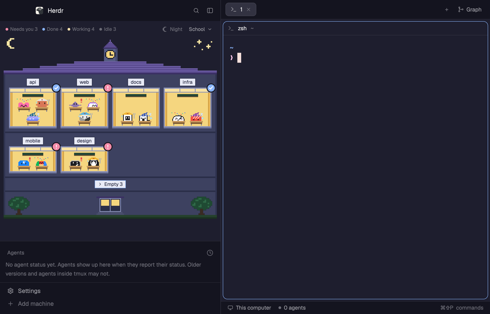

# herdr-rooms

A [Herdr](https://herdr.dev) layout that draws your spaces as rooms in a pixel-art building.
Every agent sits at a desk in its room, dressed for what it is doing.



## What you see

| Status | The occupant |
|---|---|
| Working | Hard hat and wrench; hops for a few seconds when it starts |
| Needs you | A raised hand or a big red `!` |
| Done | Confetti |
| Idle | A starry nightcap |

- **Six buildings.** School, apartment, hotel, submarine, rocket and castle.
  Pick one from the header.
- **Day and night.** The sky follows your local sunrise and sunset.
- **One look per agent.** Claude Code, Codex, Crush, Kiro, Pi, Gemini, Cursor, OpenCode,
  Amp, Grok, Antigravity, Kimi, Qoder and Hermes each have their own occupant,
  drawn after the icon Herdr ships for it.
  Any other agent, GitHub Copilot included, shows as a gray Claw'd.
- **Hover and click.** Hover a room to see who is in it.
  Click to jump to the space or to the agent.

The preview uses the `catppuccin-mocha` theme with a 480px sidebar.
The layout itself follows your theme.

## Install

1. Copy the files into your Herdr config.

   | From this repo | To |
   |---|---|
   | `layouts/rooms.json` | `~/.config/herdr-app/layouts/` |
   | `mods/rooms/` | `~/.config/herdr-app/mods/` |
   | `mods/tabs-graph/` | `~/.config/herdr-app/mods/` |
   | `mods/agents-calm/` | `~/.config/herdr-app/mods/` |
   | `mods/pane-calm/` | `~/.config/herdr-app/mods/` |

2. Add [git-graph](https://github.com/rabeeh-ta/herdr-git-graph) for the right panel,
   or remove the `graph` block from `rooms.json`.

3. Check the mods and switch to the layout.

   ```sh
   for m in rooms tabs-graph agents-calm pane-calm; do herdr-app check ~/.config/herdr-app/mods/$m; done
   herdr-app do layout.switch '{"name":"rooms"}'
   ```

## Good to know

- The right-click menu on a room runs `git`, `gh browse`, `open` and `pbcopy`,
  so it works on macOS only.
  Nothing else runs programs or reaches the network.
- It is built to stay light. Every picture is a static SVG, and an occupant hops
  only for its first 3 seconds of work.
- `agents-calm` and `pane-calm` are Herdr's own agent list and pane header
  with the spinning working icon held still. A spinner on screen redraws the whole
  window about 30 times a second, which cost about 9% CPU in our measurement.
- The SVGs are generated by the scripts in `mods/rooms/tools/` (see its README).

## License

Apache-2.0. `NOTICE` lists the parts taken from Herdr and herdr-session-titles.

Agent names and marks belong to their owners.
The occupant sprites are fan art drawn after them and grant no trademark rights.
