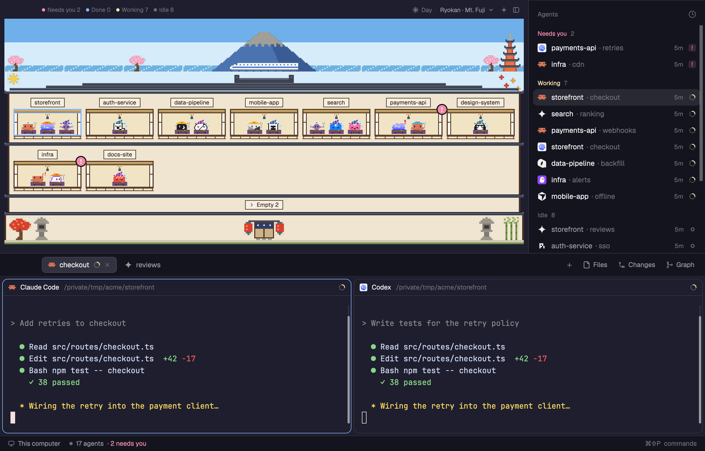

# Rooms

Your spaces are rooms in a pixel-art building, and every agent is an occupant at the building's furniture, dressed for what it is doing: a hard hat while it works, a raised hand or a big "!" when it needs you, confetti when it is done, a nightcap while it sleeps. Each agent kind has its own occupant, drawn after the icon Herdr ships for it. The building follows the time of day and is one of nine: a school, an office, an apartment, a hotel, a submarine, a rocket, a castle, a ryokan or a sento. It can stand in one of four towns (Tokyo, Kyoto, Osaka, Mt. Fuji), which paint a sky and landmarks over its roof. It sits in the sidebar or in a band across the window's top.

## What you see

- **Left sidebar, 268px:** the brand row (46px, shipped `workspace-chrome`), then the building and the agent list (`agents-calm`) sharing the rest half and half, then the footer (69px, `workspace-chrome` with `{footer: true}`).
- **The building (`rooms` mod):**
  - A header row: counts per status (`Needs you`, `Done`, `Working`, `Idle`), `Day`/`Night`, the building's name with its town (`Ryokan · Mt. Fuji`; a press lists the nine buildings, then `Town` and the five choices from `No town`), a `+` that makes a space, and a button that moves the building to the top or back to the side (shown only when the other layout exists).
  - With a town, a band 64 art pixels tall over the roof: the town's sky (two tones), a far row repeated across the width (skyline, hills or a lake), landmarks at the sides and toward the middle, and for Tokyo and Mt. Fuji a bullet train in front. The lower sky tone continues behind the roof.
  - Under it the building art: a roof line and a clock tower or the building's own top, then floors of windows. One window is one space, with its name on a white plate above it.
  - Rooms with agents come first, the most recently changed first. Rooms without agents sit under a plate `› Empty N` that folds them away or shows them (`⌄ Empty N`).
  - Each room shows one seat per agent with its occupant behind it: a desk (school, office), a sofa (apartment), a bed's quilt (hotel), a console with two lights (submarine, rocket), a cushion and low table with a teacup (castle, ryokan) or a wooden tub of water (sento). They hide the occupant below its shoulders.
  - A window's top-right corner carries a red `!` badge when someone in it waits for you, or a blue check when someone finished.
  - Night (between sunset and sunrise, reckoned for the local time zone) darkens the sky; a room whose occupants all sleep turns its lights off.
- **Across the top (`layouts/rooms-top.json`):** a band 460px tall over the whole width, the building (`rooms` with `{strip: true}`, weight 1, `window_drag`) left of the agent list (`agents-calm`, weight 1), with a 1px divider; both borders drag. The header starts 76px in on macOS for the traffic lights. Under the band: the tabs bar, the panes and the status bar as in the sidebar layout. In the band the art may grow to 1.5 times the usual pixel size when the rooms fit.
- **Right of it:** the panes, each with a header (`pane-calm`), with the tabs bar above (`tabs-graph`, 42px, a copy of the shipped `tabs` with a Graph button) and the status bar below (`workspace-status`, 28px).
- **Right panel, 368px:** a stack of the shipped `files` and `changes` mods and `git-graph` (see Watch out).

## How it behaves

- **working:** yellow-or-other hard hat with a wrench and a sweat drop; for its first 3 seconds of work the occupant hops between two spots about 3 times a second, then sits still.
- **blocked:** eyes look up and a red `!` appears (Claw'd occupants also raise a hand); the room gets the red badge.
- **done:** `^ ^` eyes, blush, confetti; the room gets the blue check.
- **idle:** closed eyes, a starry nightcap, `Z` and a snot bubble.
- The same agent always wears the same hat color (4 colors, picked from its address).
- Hovering a window for 220ms opens a roster card: each occupant with its name and status. A click on a row focuses that agent's pane; a click on the window selects the space. Right-click between the rooms opens `New space` and `New space with <agent>` (the first installed agent from `knownAgents()`). Right-click on a room opens a menu (open the folder, in VS Code, copy the path, open the repository with `gh browse`).
- The building scales its art in whole screen pixels (4, 3 or 2 per art pixel on a 2x screen) and its number of columns so that the rooms with agents fit the panel; empty rooms opened under the plate scroll instead of shrinking it.

## Built from

- `layouts/rooms.json`: the node tree above. It sets `terminal_opacity: 1` and `titlebar: "none"`.
- `mods/rooms/`:
  - `main.js` (the view, the fit, the roster, the commands `next-building`, `next-town`, `toggle-empty`, `toggle-place` from `nextCommand()`), `looks.js` (nine buildings' palettes, window dressing and seats; the four towns), `art.js` (sizes of the SVGs in `icons/`), `sun.js` (sunrise and sunset), `session.js` (an agent's session name from its terminal title), `menu.js` (the right-click popup).
  - `sprites/<body>-<hat>-<status>.svg`: 15 bodies × 4 hat colors × 4 statuses = 240 pictures. Bodies are `claude` and `other` (Claw'd, recolored) and `codex`, `crush`, `kiro`, `pi`, `gemini`, `cursor`, `opencode`, `amp`, `grok`, `antigravity`, `kimi`, `qoder`, `hermes`.
  - An occupant's body comes from `program.key` of the agent (the program table folds names like `kiro-cli` into `kiro`), else from the agent's reported `app`.
  - `tools/`: the Python scripts that draw every SVG (`occupants.py`, `scene.py`, `buildings.py`; see `tools/README.md`).
- `mods/agents-calm/` and `mods/pane-calm/`: the shipped `agents` and `pane` (0.1.12) cloned with `mod.clone`, their working spinner (`.spin(900)`) held still. `tabs-graph` holds its spinner still too.
- `herdr` functions: `spaces()`, `agents()`, `theme()`, `settings()`, `props()`, `window()`, `layouts()`, `shared()`/`setShared()` (`rooms.building`, `rooms.town`, `rooms.fold`, so the sidebar and the band agree; `localStorage` is per props), `nextCommand()`, `run("space.select" | "pane.focus" | "space.new" | "layout.switch")`, `openOverlay`, `knownAgents`, `exec` (menu only).
- Programs it runs, from the right-click menu only: `git rev-parse`, `gh browse`, `open`, `open -a "Visual Studio Code"`, `pbcopy`.

## Watch out

- The right panel uses `git-graph`, which is not in this repo: add it from github.com/rabeeh-ta/herdr-git-graph, or drop the `graph` block from the layout.
- The right-click menu is macOS-only (`open`, `pbcopy`, VS Code by app name).
- Every redraw of a mod redraws the whole window, so nothing here moves for long. Measured on Herdr 0.1.12 with 9 rooms and 14 agents: idle 1.2% CPU; a native `.spin()` or `.loop()` anywhere on screen, +9% to +23% while shown; the 320ms hop, +5% while it runs. Hence the still spinners and a hop of 3 seconds. Don't add native loops, spinners or per-frame animation.
- Sprites are 19×15 with the face in rows 4–10: the seat hides rows 11 and below in the room (the tub and the bed from row 10), but the roster card shows the whole sprite.
- The side/top button pairs layouts by name: `<name>` and `<name>-top`.
- A block given `window_drag` drags the window from any press that isn't stopped, so every control in the band stops the left press.
- `child(null)` throws: add the town band with `.when(...)`.
- GitHub Copilot agents show as the gray Claw'd (`other`) on purpose: GitHub asks for approval before its mascot is used in public.

## Done when

- `herdr-app check` passes for `mods/rooms`, `mods/tabs-graph`, `mods/agents-calm` and `mods/pane-calm`, and `layout.switch {name: "rooms"}` and `{name: "rooms-top"}` show the building with no errors in `herdr-app status`.
- `herdr-app do rooms.next-building` and `rooms.next-town` step through the nine buildings and five town choices in both layouts, which show the same pick; `rooms.toggle-place` switches between them.
- With agents running, each sits in its space's room, dressed for its status, and the counts in the header match the agent list.
- Resizing the panel changes the art size or the columns without errors; opening `Empty N` lets the panel scroll.
- `python3 -I tools/occupants.py sprites` regenerates `sprites/` byte for byte.
